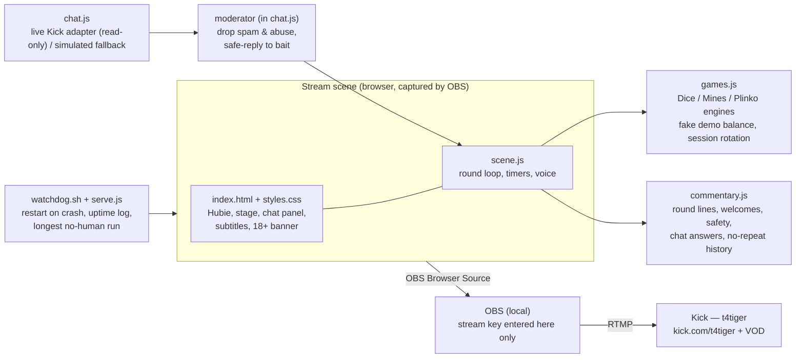

# Hubie, Live 24/7 — AI streamer (v1.6)

An autonomous AI streamer built for the **Housebets Contest Labs — "Hubie, live 24/7"**
product contest (closes **14 Nov 2026, 18:00 UTC**). Hubie — Housebets' AI mascot and
rewards host — plays **House originals in demo mode only**, commentates every round,
reads chat and answers viewers **by name**, moderates chat, and runs with **no human**
once it is live. Demo play only: no real money, no logins, no deposits, ever.

> **Status: ENTRY SUBMITTED — Sat 14 Nov 2026, before the 18:00 UTC close.**
> Submitted recording: the soak-test run of Fri 13 Nov 2026 — **5h 05m 22s
> with no human** by Kick's VOD duration (local counter: 5h 08m 33s
> unbroken). Streamed live on Kick — t4tiger — https://kick.com/t4tiger —
> from 18:52 to 00:02 WAT. Final counters: **5,311 lines spoken / 5,310
> displayed, 0 dropped**, closing sign-off delivered. Recording:
> https://kick.com/t4tiger/videos/01a1d609-c558-74d1-b6e9-8f0d1f605066
> (Kick keeps it until 20 Nov 2026; a local master copy is held by the
> author). Full record: `logs/test-2026-11-13/tonight-run.test-final.json`.
> Run 5 (14 Nov, the planned judged run) totalled ~8h 28m across 7
> segments, longest 1h 53m 55s: repeated host VM replacements broke every
> segment before the 3-hour minimum, so it produced no qualifying
> recording — full record in `logs/tonight-run.json`.
> Run 4 (Sun 8 Nov 2026): **5h 46m 37s with no human**, 5,795 lines spoken
> == 5,795 displayed, 0 dropped, zero encoder restarts and zero relay
> events all run; it ended when the host VM restarted 13 minutes before
> the planned 6-hour stop — the stream stack itself never failed.
> Recording: https://kick.com/t4tiger/videos/01a1bb86-dc20-7bce-8db5-ff9615d6e52d
> (Kick kept it until 15 Nov 2026) — full record in
> `logs/tonight-run.attempt4.json`.
> Earlier attempts, briefly: run 1 (7 Nov, ~9 min) was cancelled by
> Oluwatoba after the voice trailed the subtitles. Run 2 (8 Nov, ~13 min)
> was ended by Oluwatoba for the same screen/voice mismatch; both drove
> the coupled speech-director rebuild in v1.4. Run 3 (8 Nov) held perfect
> sync for 44 minutes before the upstream stream connection closed; that
> drove the supervised auto-reconnect transport layer in v1.6.

> **v1.1.1 (2026-11-06):** big-amount demo scale, per Oluwatoba's direction — the demo balance now starts at **1,000,000 coins**, round stakes run **1,000–25,000**, and the auto-refill tops back up to 1,000,000 when the balance falls below 1,000. Multipliers, game maths and everything else from v1.1 are unchanged. *(Balance model superseded by v1.3 below.)*

## What's new in v1.4 (2026-11-08) — coupled screen/voice sync

The 2026-11-08 judged run was ended by Oluwatoba at 10:12 WAT after
~13 minutes: "what's on screen different from what's playing". Measured
cause: the engine produced ~439 lines, the voice spoke 190 and dropped
249 (114 stale + 135 overflow), while subtitles displayed every
generated line the instant it was generated. v1.4 makes the **voice
service the single source of truth for what is being said**:

- **Speech events.** Every line carries an id. The voice service emits
  `speech-started` / `speech-ended` / `speech-dropped` over a journaled
  SSE stream (`GET /events`, replay via Last-Event-ID, `sync` snapshot
  on connect) at the exact FIFO byte offsets where a line's audio
  starts and ends. `GET /sync` merges service counters + the scene's
  telemetry + the event journal; the scene reports its counters via
  `POST /telemetry`.
- **Subtitle coupling** (`js/speech-director.js`). The scene renders a
  commentary subtitle ONLY on `speech-started`, showing that event's
  exact text, and clears it on `speech-ended`. Nothing is ever on
  screen that is not being spoken at that moment — displayed == spoken
  by construction. (Viewer chat lines are chat, not commentary, and are
  unchanged.)
- **Generation pacing.** Commentary is submitted as lazy *intents*
  (kind + priority + optional TTL + generator). At most ONE intent may
  pend behind the speaking line; it is generated only when a speech
  slot opens. Priorities: closing 110, result 100, anticipation 80,
  chat 70, segment 65, sizing 60, reminder 45, opening 40, rewards 10.
  A fresher intent at >= priority replaces the pending one
  (`intentsReplaced`); a lower-priority newcomer is turned away
  (`intentsDropped`); a pending intent whose moment passes expires
  (`intentsExpired`). Games keep animating — only commentary generation
  is gated. The voice service's own queue discipline stays as a safety
  net, and its drops are now events, not silent losses.
- **Off-air proof** (`scripts/proof-run.sh` — local stack + local
  ffmpeg recording, NO RTMP anywhere; `scripts/verify-proof.js`,
  `scripts/verify-transcribe.py`). The 330s proof recording
  (`demo/hubie-coupled-proof.mp4`) measured: 213 intents submitted →
  **87 generated == 87 spoken == 87 displayed**, with the exact same
  line-id set and texts in the service log and the scene log; service
  drops **0** (was 249); pacing absorbed the rest (72 replaced, 48
  turned away, 5 expired — anticipation beats whose reveal window
  closed). Transcription spot check (faster-whisper small): **11/12**
  sampled lines matched the audio (the 12th matched its tail verbatim;
  its head fell outside the sampled transcript window). Contrast with
  the failed run: 439 produced / 190 spoken / 249 dropped.
- **Known residuals (honest).** (1) Result-line intent→speech lag:
  median **1.71s**, p90 4.5s, max 6.5s over 58 results — a result waits
  for the in-progress burst to finish (it never interrupts), so the
  "~1s typical" target is NOT met on the median; post→audio lag itself
  is 0.19s max. (2) **Feeder clock drift**: the voice feeder emits
  exactly 100ms of audio per 100ms tick regardless of elapsed wall
  time; when ticks slip under CPU load, stream time is lost and the
  muxed audio timeline compresses (~5% measured in the proof: audio
  led wall/video time by ~8s at 100s in, ~14s at 215s in). The coupling
  is unaffected (events are byte-true), but the proof recording's A/V
  tracks drift by that amount, and a long live run could drift the
  same way. Fix before any relaunch: clock feeder emission by elapsed
  wall time (emit the audio/silence actually owed), or cut CPU load.
  **FIXED same day (voice service v3.2, below).**

## What's new in v1.5 (2026-11-08) — wall-clock feeder + relaunch attempt

- **Feeder clock fixed** (`scripts/voice-service.js` v3.2). The feeder
  now runs an emission ledger clocked by elapsed wall time: bytes owed
  = elapsed × sample rate, and every tick emits exactly the shortfall
  (speech first, silence after; discarded at the same rate while no
  reader is attached), so a slipped tick is followed by an equal
  catch-up emission. `/health` exposes `emittedSec` vs `feedWallSec`.
  New test drives a fake clock with deliberately slipped ticks: 4.000s
  of audio emitted for 4.000s of simulated wall time across 10
  irregular ticks (the old feeder emits 1.0s on the same drive).
  **Tests: 27/27 green.**
- **Re-proof (off air, 330s)**: coupling exact again — 97 generated ==
  97 spoken == 97 displayed, service dropped 0. Drift measurement
  (`scripts/measure-drift.py`, whisper-vs-journal anchors, 85/87 lines
  matched): anchors −2.46/−2.39/−2.33s at 60/180/300s, fitted slope
  **−0.02%**, band-median growth +0.13s over ~250s — the compression is
  gone; the constant ~−2.4s is the ffmpeg launch latency in the
  measurement epoch, present from the first lines (analysis:
  `logs/proof-drift-analysis.json`). Result lag: median 1.51s, p90
  4.13s, max 5.01s (accepted design, unchanged).
- **Relaunch attempt (2026-11-08 11:45 WAT)**: dress checks (a)–(f)
  all green — live with exact title/category, HLS audio −19.2/−18.1 dB
  mean, displayed == spoken at every sample with 0 drops, chat bridge
  live, scene rotating Plinko → Mines → Dice, and on the real feed the
  audio timeline measured wall-true (inter-line spacing ratio 1.014
  over 63.6s; feeder ledger gap ≤0.09s all run). **The stream then died
  at ~44 minutes**: the RTMPS CONNECT relay's upstream closed
  (11:29:58Z), ffmpeg hit "Connection reset by peer" and exited, and
  the stack was stopped cleanly with the channel verified offline.
  Full record in `logs/tonight-run.json`. Transport resilience — not
  voice, not sync — is now the binding constraint on a 3h+ run.
- **Tests: 26/26 green** (`node tests/test.js`) — the 20 pre-existing
  plus 6 new: subtitle only on speech-started, the one-pending pacing
  gate, priority replacement, anticipation expiry, a simulated session
  asserting displayed == spoken, and the voice-service event/SSE/sync
  contract. Demo bundle rebuilt from the new code (director included;
  in the bundle it runs in local mode — no bridge — and subtitles show
  at generation time as before).

## What's new in v1.6 (2026-11-08) — transport diagnosis + supervised auto-reconnect

- **Diagnosis of the 44-minute death.** The old relay's log shows the
  upstream (proxy-side) leg closed first, cleanly, at 44m14s — no error
  on either leg — which points beyond this machine (egress proxy or
  Kick ingest), not at the relay code or the local network. A 2h+
  off-air soak (instrumented relay vs a direct control at identical
  bitrate, plus live-proxy downstream/upstream probes) backs that up;
  the proxy-vs-ingest question stays honestly open, and the production
  relay is now instrumented to settle it on any future drop
  (`firstCloser`, `hadError`, errno, byte counters per leg). Full
  write-up: `logs/transport-report.md`.
- **The encoder is now a supervised child** (`scripts/encoder-supervisor.js`).
  ffmpeg exiting — for any reason — no longer ends the run:
  `stream.sh`'s trap fires only on operator stop, and the supervisor
  restarts the encoder on the same sources and target with a 3s first
  retry and a 3s → 5s → 10s → 20s capped backoff, unlimited retries,
  every event appended to `logs/transport.log`. A stable run (≥60s)
  resets the ladder. The **relay is supervised too**: `watchdog.sh`
  restarts it ~2s after any exit, so no single transport process is a
  point of failure.
- **Relay v2** (`scripts/rtmp-relay.js`): structured lifecycle logging
  on both legs, TCP keepalive (15s) + noDelay, half-open detection,
  graceful FIN propagation (the old instant `destroy()` is what handed
  ffmpeg its "Connection reset by peer"), and no dropped
  pre-handshake bytes. Same interface: ffmpeg still points at
  `127.0.0.1:1936`.
- **Forced-drop verification (off air, local sink):** encoder killed
  3× — sink-visible gaps ~12s / ~5s / ~13s, restart delays 3s / 3s /
  5s (backoff escalating as designed); relay killed once — watchdog
  resurrection ~3s, full recovery ~20s end to end. Across all four,
  the scene, Chrome, Xvfb, serve and voice PIDs never changed,
  `spoken`/`displayed` deltas stayed 1:1 and dropped stayed 0 — the
  show demonstrably never restarts when the transport does. The
  verification also caught and fixed a real supervisor liveness bug
  (an `unref()`'d restart timer let the process exit mid-delay), now
  guarded by a subprocess regression test. **Tests: 33/33 green.**
- **Honest residual:** a fast reconnect on the same key *should* read
  to Kick as one continuous session with a brief freeze — that is the
  design goal — but only a real run can confirm how Kick records it.

## What's new in v1.3 (2026-11-07 night) — sync, commentary and balance overhaul

Ordered by Oluwatoba after he cancelled the judged run above. All local;
nothing relaunched.

- **Voice sync fixed, with numbers.** Diagnosis of the old service: the
  queue ran up to 4 lines deep and Piper emits each line's audio in one
  batch at the end of synthesis, so commentary bursts stacked 10+ seconds
  of invisible backlog — the voice was still describing old rounds
  (subtitles led by ~5–10s in the live run). The v2 service enforces
  strict queue discipline: **at most one line waiting** behind the one
  being spoken; a line is only sent to Piper if it can **start within
  ~3 seconds** of being posted; a fresher post replaces the waiting line;
  every drop is counted in `/health` (`spoken`, `droppedStale`,
  `droppedOverflow`, `lastStartLagSec`, `maxStartLagSec`). Subtitles
  always show every line — only the voice skips what it can no longer
  say in time. Three pace lanes vary Piper's `length_scale` by line type
  (fast 0.88 wins/anticipation, normal 0.95, slow 1.08 losses).
- **Voice model chosen by measurement, not by name.** `en_US-ryan-high`
  was tried first and **rejected**: its synthesis real-time factor on this
  VM is 1.66–5.11 — slower than real time, so it can never stay in sync.
  Adopted **`en_US-ryan-medium`** (same voice, RTF 0.39–0.88). Verified
  against the real service: 23 posted lines → 19 spoken, 4 dropped (all
  replaced-overflow, 0 stale), spoken start lags 1.40–3.10s — inside the
  ~4s bar (the ryan-high burst had lags up to 17.99s). Approval sample:
  `demo/hubie-new-voice-sample.wav` / `.mp3` (33.4s, new voice + new
  style across a win, a loss and a game switch).
- **Commentary v2 — Hubie talks like a streamer.** Every spoken line is a
  short burst (a few words to one short sentence, 1–3s of speech)
  carrying only the stake, the current action and the result, with
  doubled hype phrases ("five thousand. five thousand riding."). Wins
  shout then call the figures; losses are frustrated, never swearing;
  cold streaks narrate the game switch. Rewards survive only as punchy
  one-liners with the verified figures (rakeback 10%, VIP 12.5%, total
  22.5%, Bronze 1 at 200 XP). Chat answers are short and by name.
- **Balance story.** The roll starts at **100,000** (was 1,000,000).
  Stakes are percentage-based off the current balance (base 1–2.5%,
  floor 500, occasional ~5% send-its; tiers press ×1.5 at ≥250k, ×2 at
  ≥500k). The quiet auto-refill is gone: below 5,000 Hubie **busts** and
  a narrated **reload of 50,000 or 100,000** lands, shown on screen as
  `RELOAD +<amount>` and tracked in the HUD (reload count, total bought
  in). Outcomes are not rigged — the arc comes from percentage staking
  plus reloads. Simulated ~3-hour sessions: one ran 100k → peak 238,748
  → 12,465 with no reload; two others busted once each (total in 150k /
  200k) and ended at 53,923 / 46,760.
- **The word "demo" is rationed.** The scrolling banner carries the
  disclaimer on screen at all times, so the voice and the scene UI no
  longer repeat it: amounts are plain numbers, the balance caption is
  just the number, the reload label is `RELOAD +100,000`. Spoken, the
  demo nature is said exactly three times per run — the **opening**
  line, **one sparse mid-stream reminder** (engine cadence: first due
  ~2.5h in, then no more often than ~2h), and the **closing** sign-off.
  The old every-10-minutes vocal safety rotation is removed. Graceful
  stop hook: call `window.__hubieClosing()` or dispatch a
  `hubie:closing` event, wait a few seconds for the sign-off, then tear
  the stack down.
- **Tests: 14/14 green** (`node tests/test.js`). The commentary checks
  were rethought for short lines (hype repetition is intended; the
  contract is now: ≤140 chars, no back-to-back identical lines,
  figure-bearing lines effectively unique, paces routed, NO "demo" in
  any regular line, the three sanctioned demo moments present, and the
  sparse reminder cadence asserted). One older assertion was also fixed:
  it demanded the stake wording from a single template draw, but that
  wording lives in 2 of 3 win templates by design — it now checks the
  contract across 12 win lines.

- **Research-bank merge + finish pass (2026-11-07, later).** The line
  bank in `research/streamer-patterns.md` (patterns sampled from jkolby,
  jerzynft and syken VODs) was merged into the commentary engine where
  it fit the evidence better: anticipation gained "imagine the big one
  here", "land it. land it", "do something. wake up"; switches gained
  the "hop" phrasing; chat gained crowdsourced game calls ("give me a
  game, chat. give me a call."). The structural change is **win
  grading by multiplier**: a small win (stake back to ~2x) now gets
  FLAT acceptance (a few words, the figure read plainly, normal pace —
  the research pattern), a solid win keeps the shout + figures, and
  only 10x+ draws the massive bank. (Grading uses the multiplier, not
  the games' `bigWin` flags, which trip as low as 2.1x on Plinko.)
  Research-bank lines containing the word "demo" were NOT merged — the
  demo-wording rule above wins. One reload template ("my own money")
  was also reworded so Hubie never implies real money. In the scene,
  the anticipation beat now fires on ~2 of 3 rounds only — the research
  is explicit that silence is a tool. Two multiplier assertions in the
  tests became spread checks (the merged massive bank includes
  disbelief-only lines like "session saved. session saved." alongside
  the figure callouts, so a single draw can legitimately carry no
  number). The test suite also **exits cleanly now**: the voice test
  attaches a dummy FIFO reader (as ffmpeg does in production) — without
  one, the service's FIFO open pends forever and the test process hung
  after passing. New approval sample: `demo/hubie-voice-sample-v2.wav`
  / `.mp3` (32.8s — sizing + anticipation, a solid 4x win, a 50x
  massive, a loss, a cold-streak hop to Mines, and a bust/reload,
  spoken by en_US-ryan-medium through the service's pace lanes).
  Simulated 2-hour session (600 rounds, scene settings): 100,000 →
  peak 121,510 → 6,908, stakes 500–6,000, no reload needed (two further
  seeds: one 50,000 reload, ends 36,375 / 31,798).

## What's new in v1.1 (2026-11-06)

Built from Oluwatoba's own phone recording of the real, signed-in Housebets
site — so Hubie now matches the actual product instead of a guess:

- **Official Hubie avatar.** The scene's face is now the real Hubie — the
  cartoon sloth in a top hat and bow tie — cropped from the rewards-chat
  avatar in that recording (`assets/hubie-official.png`; provenance and crop
  details in `assets/README.md`). The v1 placeholder SVG is retired to
  reference-only. The art pack (`hubie-art-pack.zip`) remains the preferred
  source and replaces the crop when available.
- **Real rewards structure in the commentary.** A rewards explainer rotation
  (every ~8 minutes, and in chat answers) uses the verified numbers from his
  Rookie account: **total rewards 22.5% = 10% rakeback + 12.5% VIP rewards +
  Hubie rewards on top** (that slice shows as "?" on the real card, so Hubie
  never puts a number on it), and **XP levels — Bronze 1 at 200 XP** (his
  account: 29 XP, 171 to go). Figures stay exactly as verified.
- **Hubie's real voice register.** A casual tone pass through the commentary:
  dry openers and fillers in his register ("hey hey", "what's up though",
  "how's it going"), and a new "tip" chat topic answered the way the real
  Hubie answered it — *"not today man, nothing to toss your way right now"* —
  which doubles as a safety line: a tip is never a promise. All existing
  safety rules stand (no win promises, no deposit pushing, demo only).

## Channel

| | |
|---|---|
| Platform | Kick |
| Channel | **t4tiger** |
| Live channel link (for the submission) | **https://kick.com/t4tiger** |
| Stream key | **Never in any tracked file.** At go-live it goes only into the untracked, gitignored `config/stream.local.json` (read by `scripts/stream.sh`). See `config/stream.example.json` for the shape. |

## Run it locally (2 minutes)

No build step, no dependencies. You need Node (for the tiny static server) or any static file server.

```bash
# Option A — with the watchdog (recommended; this is the no-human runner)
bash scripts/watchdog.sh          # serves on http://127.0.0.1:8377 and restarts itself

# Option B — plain server, no watchdog
node scripts/serve.js 8377        # then open http://127.0.0.1:8377/
```

Open the page and you will see the full broadcast scene: Hubie (official avatar —
see below), the demo game stage, live commentary subtitles, the chat panel, uptime clock,
demo balance, and the permanent **“18+ Gamble responsibly — demo play, no real money”**
banner. Rounds start on their own and never stop.

**One setup click:** browsers block audio until a human gesture, so before going live
click **“Enable voice (setup)”** once. That is a setup step, done before the run starts.
After that, nobody touches anything — any human action during a run resets it to zero
under the contest rules.

## Point OBS / ffmpeg at the scene

**OBS (recommended):**
1. Add a **Browser Source**, URL `http://127.0.0.1:8377/`, width 1920, height 1080.
2. Settings → Stream → Service: **Kick**. Server and **Stream Key**: copy them from
   t4tiger's Kick dashboard (Creator Dashboard → Settings → Stream Key) and paste them
   **into OBS only**. Never paste the key into this repo, a chat, or a commit.
3. Start the watchdog first, start OBS streaming second — that moment is the start of
   the no-human run.

**ffmpeg (scripted, this repo):** `scripts/stream.sh` runs the whole pipeline —
Xvfb + Chrome kiosk on the scene + ffmpeg x11grab, H.264/AAC at 720p30, ~4500 kbps —
and pushes RTMP to the ingest in `config/stream.local.json` (untracked; the key is
read at runtime, never printed, never committed). `scripts/stream.sh --dry-run 75`
pushes to a local RTMP sink instead for pipeline tests; nothing goes public.

## Kick chat (live adapter, read-only)

Implemented in `js/chat.js` (`KickChatAdapter`), enabled per environment through the
existing config pattern (`config/stream.example.json` → untracked
`config/stream.local.json`, `kickChat.enabled`):

- Resolves t4tiger's chatroom id from Kick's public channel API at connect time
  (verified live 2026-11-07: chatroom **72832211**), then asks Kick's public realtime
  endpoint which Pusher app the chatroom lives on (Kick rotates these; the adapter
  re-asks on a 4001 error) and subscribes to `chatrooms.<id>.v2` — no auth, no keys.
- `App\Events\ChatMessageEvent` payloads are parsed into `{ id, user, text, ts,
  platform: 'kick' }` and flow through the **moderator first** (`HubieChat.moderate`),
  then the responder, exactly like the simulated feed does in `js/scene.js`.
- **Read-only by design:** `sendMessage` throws. Hubie answers on stream (voice +
  subtitles + chat panel). Posting *as* a bot would need a separate, user-approved
  bot auth step — not built, and no token may ever be committed.
- The **simulated feed stays the fallback**: it runs until the adapter connects, and
  the scene falls back to it whenever the adapter is offline. Reconnect uses
  exponential backoff (1s → 30s cap).
- **Live test (2026-11-07):** connected to Kick's Pusher, received
  `pusher:connection_established`, subscribed to `chatrooms.72832211.v2`, received
  `pusher_internal:subscription_succeeded`; 0 messages in the window (channel
  offline — expected).

**Chat bridge (2026-11-07, go-live night) — the route that actually runs.**
The adapter above can never connect *inside the streaming Chrome* on this
VM: `scripts/stream.sh` passed Chrome `--proxy-server="$https_proxy"`, and
that proxy URL carries embedded credentials, which Chrome rejects wholesale
— every proxied request from the page (channel API, credential POST,
Pusher websocket) died with `net::ERR_NO_SUPPORTED_PROXIES` (CDP-verified
from the scene page). Localhost is proxy-exempt, so the scene and voice
bridge worked while chat silently never took over. The fix:
`scripts/chat-service.js` runs the same adapter in Node (where it connects
fine) and serves the scene on localhost — `GET /events` (SSE: `status`
events for connect/disconnect + `message` events in the adapter contract)
and `GET /health`. The scene (`kickChat.bridgeUrl` in the local config)
stands the simulated feed **down** while the bridge reports connected and
**back up** when it drops; `stream.sh` no longer passes Chrome any proxy
at all (the page only talks to localhost services now). The bridge is
read-only like the adapter — it has no send path (POSTs get a 405).

## Recording / VOD (the submission evidence)

1. **Kick saves VODs automatically** — there is no "store past broadcasts" toggle on
   Kick (that is Twitch wording; verified 2026-11-07). Every finished stream becomes a
   VOD, kept **7 days** on a non-verified channel (30 days verified). Plan: after the
   run, **download the VOD and mirror it to YouTube before the 7-day expiry** — contest
   results land 7 days after the 14 Nov close, so the Kick copy alone is not safe.
2. Run Hubie untouched for **3+ hours minimum**; longer no-human runs score higher.
   The watchdog's `logs/longest-run.txt` records the longest uninterrupted server run
   as supporting evidence; judges cross-check against the channel's stream history.
3. The submission recording link can be the **Kick VOD** or a **YouTube** upload of the
   unedited run. **Keep VODs up until results are out.**
4. Submission form will need: recording link (3h+), this repo's public link, live
   channel link (**https://kick.com/t4tiger**), the stack (below), and the longest
   no-human run in hours.

## Stack (submission disclosure draft)

- **Scene:** hand-written HTML/CSS/JS, no build step, no framework (`index.html`, `css/`, `js/scene.js`)
- **Game engines:** original JS demo engines — Dice, Mines, Plinko — fake balance only (`js/games.js`); plus our own demo **Slots** engine, played only as a short casino-break segment between originals (see go-live notes)
- **Commentary:** original template/variable engine — short streamer bursts only (stake / action / result), pace-tagged per line type, no back-to-back verbatim repeats (`js/commentary.js`)
- **Voice:** local Piper TTS, model `en_US-ryan-medium`, via `scripts/voice-service.js` (the scene POSTs each line; the service speaks it into the stream's audio FIFO). Strict queue discipline: at most one line waiting, anything that cannot start within ~3s is dropped and counted — the voice never speaks stale lines. Browser speech synthesis has zero voices on this VM and is not used.
- **Chat:** real read-only Kick chat for t4tiger via `scripts/chat-service.js` (the js/chat.js adapter running in Node, forwarded to the scene over localhost SSE) with the simulated feed as automatic fallback; original moderator filter (`js/chat.js`)
- **Animation:** full-body Hubie mascot (`assets/hubie-fullbody.png`, from Oluwatoba's image, cut out locally) with transform-based idle/talking/win/big-win/near-miss/loss reactions driven by round events (`js/scene.js`)
- **Runner:** zero-dependency Node static server + bash watchdog with uptime/longest-run logging (`scripts/`)
- **Streaming:** Xvfb + Chrome kiosk + ffmpeg x11grab → Kick RTMP (`scripts/stream.sh`; key only in untracked `config/stream.local.json`) — OBS Browser Source works too
- **Tests:** Node, no test framework (`tests/test.js`)

## Architecture



## Safety, by design

- Play-money balance only. When it busts, a reload event lands on screen labelled
  `RELOAD +<amount>` — Hubie's own play money, never a deposit prompt.
- Permanent on-screen banner: **18+ · Gamble responsibly · Demo play — no real money**.
- Spoken, the demo nature is said exactly three times per run (opening, one sparse
  mid-stream reminder, closing sign-off); the banner carries it continuously, so
  regular commentary never repeats it. Hubie never promises wins and never pushes
  deposits — the moderator turns win-guarantee / deposit / underage bait into that
  safe reply and drops spam, links and abuse before Hubie ever sees them.
- No keys, tokens or passwords anywhere in this repo (`.gitignore` + review before pushing).

## Art: official avatar, from the real site

Since v1.1 the scene's Hubie is the **official character** — the sloth in a top
hat and bow tie — cropped from Oluwatoba's own recording of the signed-in
Housebets rewards chat (`assets/hubie-official.png`, provenance in
`assets/README.md`). The v1 placeholder (`assets/hubie.svg`) is retired and kept
for reference only; it was never official art and must never be described as such.

The contest's own `hubie-art-pack.zip` is still the preferred source (full art +
voice notes) and replaces the crop when it becomes available — it was not
downloadable from the public contest pages. **Do not stream publicly or submit
until the final art/voice state is confirmed against the pack or the brief.**

## Tests

```bash
node tests/test.js
```

Covers the game engines (200 random rounds each, 2,000 slot spins), session game
rotation, slot-break cadence and balance integrity over 500 rounds, the moderator
(drop / safe / allow cases), chat topic routing, the simulated feed, the Kick
adapter (fake-socket: resolve, subscribe, parse, read-only), the chat
bridge service (health, SSE status transitions, message forwarding,
read-only), and a **simulated hour of commentary: 750+ lines generated,
all unique — no verbatim repeats**.
**12/12 passing (2026-11-07).**

## File list

```
index.html                  the broadcast scene
css/styles.css              Housebets-colour scene styling + Hubie animation states
js/games.js                 Dice / Mines / Plinko demo engines + Slots break engine + session rotation
js/commentary.js            commentary engine (commentates every round, no repeats)
js/chat.js                  moderator, simulated chat, live read-only Kick chat adapter
js/scene.js                 browser orchestration: round loop, chat loop, TTS, timers
assets/hubie-official.png   official Hubie avatar, cropped from Oluwatoba's recording (the scene's face)
assets/hubie.svg            retired v1 placeholder (reference only — NOT official art)
assets/README.md            avatar provenance + how the official art pack drops in
config/stream.example.json  public channel facts + config shape (no secrets)
config/stream.local.json    UNTRACKED + gitignored: stream key, ingest, live chat switch (create locally at go-live)
scripts/serve.js            zero-dependency static server for the scene
scripts/watchdog.sh         auto-restart runner + uptime / longest-run evidence logs; also supervises the RTMP relay
scripts/voice-service.js    local Piper TTS bridge: scene lines -> speech in the stream audio
scripts/chat-service.js     local Kick chat bridge: adapter in Node -> scene over localhost SSE
scripts/rtmp-relay.js       local CONNECT relay so ffmpeg can hold the RTMPS publish (v2: instrumented, keepalive)
scripts/encoder-supervisor.js  supervises ffmpeg for stream.sh: fast restart, backoff ladder, logs/transport.log evidence
scripts/stream.sh           production pipeline: Xvfb + Chrome + supervised ffmpeg -> Kick RTMP (+ --dry-run local test)
scripts/soak-transport.sh   off-air transport soak (relay vs control + proxy probes) used for the v1.6 diagnosis
scripts/reconnect-test.sh   off-air forced-drop verification: kills the encoder x3 and the relay x1 against a local sink
scripts/build-demo.js       rebuilds demo/hubie-demo.html from sources
demo/hubie-demo.html        single-file demo bundle (rebuilt by scripts/build-demo.js)
demo/verification-*.png     720p frame checks: Mines layout fix + Slots break (2026-11-07)
demo/verification-recording.mp4  215s local scene recording behind those frames
tests/test.js               Node logic tests (run: node tests/test.js)
logs/                       watchdog uptime log + longest-run record (generated)
```

## Go-live prep (2026-11-07)

Done and verified locally — nothing has been streamed publicly:

- **Mines layout fixed.** The 5×5 grid was sized by width (420px) and spilled over
  the stage title/subtitle and under the result banner at 720p. It is now sized by
  the stage body's height (square, height-driven, 1fr rows). Verified two ways:
  DOM geometry probes at exact 1280×720 and under capture conditions (1279×663)
  show grid height = stage-body height, **0px overflow**, banner clear below the
  last cell row; frame grabs agree (`demo/verification-mines-720p.png`).
- **Live Kick chat adapter: working.** Read-only adapter implemented and tested
  live against t4tiger (chatroom 72832211): connection established, subscription
  succeeded, 0 messages while offline (expected). Simulated chat remains the
  fallback. See "Kick chat" above.
- **Stream pipeline dry run: passed.** `scripts/stream.sh --dry-run 70` pushed
  70 seconds to a local RTMP sink: H.264 1280×720 @ 30fps + AAC received in full
  (70.3s, ~2.3 Mbps average for this mostly-static scene under the 4500 kbps cap),
  no errors. Production uses the same script and encoder settings
  (720p30, libx264 veryfast, 4500 kbps maxrate, 2s keyframes, AAC 128k).
- **Slots casino break added.** Our own in-scene demo slot (3 weighted reels,
  paytable wins, pair = stake back, Seven/Hubie near-miss tease) plays a short
  ~5-spin **break after every 2 full rotations of the originals**, then the
  originals resume — it is a break segment, not a fourth rotation game. The
  **originals (Dice, Mines, Plinko) remain the primary content per the contest
  brief**; the slot runs on the same demo balance and stake scale, has its own
  safety-clean commentary (intro / tease / push lines, no win promises), renders
  cleanly at 720p (`demo/verification-slots-720p.png` — a three-Cherry win on
  break spin 1 of the verification run), and is covered by the test suite.
- **Demo bundle rebuilt** (`demo/hubie-demo.html`, via `scripts/build-demo.js`)
  with the Mines fix, the adapter and the slot break; the bundle itself runs the
  simulated chat (no config in the bundle by design).

**Live test results (2026-11-07 evening, after the prep above):**
- **Key + ingest proven live.** Three short test streams reached
  kick.com/t4tiger (public API confirmed `is_live`, correct title
  "Hubie Live - House Originals Demo, Your Favourite AI Rewards Host 🐻",
  category "Slots & Casino"). Two gotchas found and fixed on the way:
  Kick's IVS ingest needs the `/app/` path (the reader in `stream.sh` now
  adds it when the stored server URL is bare), and ffmpeg's built-in
  proxy handling cannot hold an RTMPS publish on this network (died
  ~30s in, three times) — the stream now goes through the local CONNECT
  relay (`scripts/rtmp-relay.js`, `HUBIE_RTMP_RELAY=127.0.0.1:1936`),
  which held indefinitely.
- **Voice: WORKING, measured.** This VM's Chrome has ZERO speechSynthesis
  voices, so browser TTS is impossible here (the "Enable voice" click
  could never have produced sound). The voice is now local: the scene
  POSTs every commentary line to `scripts/voice-service.js` (config
  `voice.bridgeUrl`), which speaks it with Piper (model in
  `voices-local/`, gitignored) and clocks it into a PCM FIFO as a
  continuous real-time feed (speech + silence); `stream.sh` reads the
  FIFO (`HUBIE_AUDIO_FIFO`) as the stream audio. Measured on the encoded
  output with the production encoder settings: mean −18.0 dB /
  max −0.0 dB over a 30s capture full of commentary (a silent bed reads
  ≈ −91 dB). The live scene+voice test ran 20:27:43 → 20:29:32 UTC with
  the FIFO attached the whole time. Known trait: in commentary bursts
  the voice can trail the subtitles by ~5–10s (queue drops stale lines
  to stay near-live).
- **Safety banner is now a marquee.** One single line —
  "18+ GAMBLE RESPONSIBLY — DEMO PLAY, NO REAL MONEY — HUBIE NEVER
  PROMISES WINS AND NEVER PUSHES DEPOSITS —" — scrolling continuously
  (~114px/s, full cycle ~11s, verified by transform measurements and
  frame grabs), replacing the old static blocks.
- **Full-body animated mascot.** The standing Hubie from Oluwatoba's
  image (`assets/hubie-fullbody.png`, cut out locally with OpenCV
  grabCut — see `assets/README.md`) presents in the right column,
  height-fitted so hat-to-shoes is always visible. CSS-transform
  animation only: idle bob/sway, talking pulse, win bounce with mint
  glow, big-win jump with gold glow, near-miss lean-in, loss droop with
  desaturation — driven by the existing round events via `react()` in
  `js/scene.js`. Evidence frames: `demo/verification-mascot-*-720p.png`.
- **Live Kick chat: FIXED via the bridge (2026-11-07, go-live night).**
  Root cause found with CDP evidence: Chrome was launched with
  `--proxy-server` pointing at a credential-bearing proxy URL and rejected
  every proxied request with `ERR_NO_SUPPORTED_PROXIES`, so the in-browser
  adapter could never connect (simulated chat carried the tests). The
  adapter now runs in `scripts/chat-service.js` (Node) and forwards real
  messages to the scene over localhost SSE. Verified with the scene open
  exactly as `stream.sh` opens it: bridge `/health` reports
  `connected: true, chatroomId: 72832211`; the page reports chat mode
  "live" with the panel header "CHAT — LIVE from Kick"; the simulated
  feed stood down (zero sim lines over 35s with the channel offline);
  no proxy/kick failures remain in the page. See the "Chat bridge" note
  in the Kick chat section. Tests are now 12/12 (bridge covered).
- **Chrome info bar: FIXED (2026-11-07, go-live night).** The bar was the
  "Chrome for Testing … is only for automated testing" infobar (~36px at
  the top of every kiosk capture; the `--no-sandbox` bad-flags bar does
  not appear in kiosk mode). `stream.sh` now launches Chrome with
  `--disable-infobars` (and no `--proxy-server` — see above). Frame grabs
  from the actual capture display verify the top of the 1280×720 frame
  is scene content (`demo/verification-golive-fixes-720p.png`).

**Judged-run startup sequence (all setup, before the run clock starts):**
```bash
bash scripts/watchdog.sh &                       # scene server + uptime log + supervises the RTMPS relay on :1936 (restarts it ~2s after any exit)
node scripts/voice-service.js &                  # Piper voice on :8379 + FIFO
node scripts/chat-service.js &                   # Kick chat bridge on :8381 (real chat -> scene SSE)
HUBIE_RTMP_RELAY=127.0.0.1:1936 \
HUBIE_AUDIO_FIFO=/tmp/hubie-audio.fifo \
  scripts/stream.sh                              # the run starts when this does; ffmpeg runs under
                                                 # scripts/encoder-supervisor.js (auto-reconnect, evidence in logs/transport.log)
```

**What remains (user's steps + go-live):**
1. Stream key + ingest are already in `config/stream.local.json` locally
   (from Oluwatoba's 2026-11-07 handover); he resets the key in the Kick
   dashboard after the run.
2. VOD plan confirmed (automatic on Kick; download + YouTube mirror after the
   run, before the 7-day expiry).
3. Run the startup sequence above; the untouched 3h+ run must finish before
   the 14 Nov 18:00 UTC close.
4. Public GitHub repo (still blocked on the repo-access grant) + submission form.
